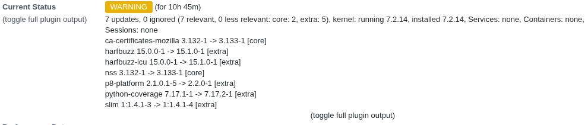
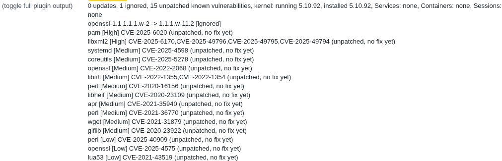

# check-pacman

A Nagios plugin for Arch Linux (and derivatives) that checks for pending
`pacman` package updates.

## What it does

`nagios-pacman-check` is a POSIX shell script that:

- Runs `sudo pacman -Sy` to refresh the package database.
- Runs `pacman -Qu` to list upgradable packages.
- Counts how many updates are pending and how many are marked `[ignored]`.
- Exits with standard Nagios states: `OK` when there are no updates,
  `WARNING` when updates (or ignored updates) are pending, and `UNKNOWN`
  if either `pacman` command fails.
- Supports `--help`/`-h`, `--version`/`-V`, and `-v`/`--verbose` (prints
  the list of updatable packages).

It depends on the standard Nagios plugin helper library `utils.sh`, which
is expected to live alongside the script (not included in this repo) and
provides `print_revision`, `support`, and the `STATE_*` exit codes.

## Screenshot

Basic check with kernel check and needrestart:

Extended check with CVEs:

## Why

Other projects:

https://github.com/dmp1ce/check_pacman, Haskell, too heavy a dependency for a monitoring station

https://github.com/liske/needrestart, Perl, checks whether running
services/sessions/the kernel need a restart after a library/package
upgrade; ships its own Nagios plugin mode (`needrestart -p`). Used by
this project's `--check-restart` flag rather than reimplemented.

## Generated with

This code was generated with [Claude Code](https://claude.ai/code) (Opus 5.5, Medium).
